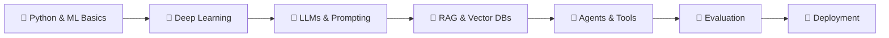

<div align="center">

# 🤖 AI Engineering Notes

### *From fundamentals to production-ready AI systems*

A personal knowledge base of concepts, tools, code and hard-won lessons for building real-world AI applications.

<br>


<br>

[📚 Topics](#-topics-covered) •
[🗂️ Structure](#️-repository-structure) •
[🛣️ Roadmap](#️-learning-roadmap) •
[🧰 Tools](#-tools--technologies) •
[🤝 Contribute](#-contributing)

</div>

---

## ✨ About

AI engineering is about turning models into **reliable, useful products**. This repository keeps my notes in one place, covering the fundamentals, working with modern language models, and taking AI systems from prototype to production.

> 💡 *Written for my own learning, but anyone is welcome to read, use and suggest improvements.*

---

## 📚 Topics Covered

<table>
<tr>
<td width="50%" valign="top">

### 🧱 1. Foundations
- Python for AI
- Linear algebra, probability, statistics
- Machine learning fundamentals
- Neural networks & deep learning basics

</td>
<td width="50%" valign="top">

### 🧠 2. Large Language Models
- Tokens, embeddings, attention, transformers
- Prompt engineering techniques
- Context windows, temperature, sampling
- Fine-tuning vs. prompting vs. RAG

</td>
</tr>
<tr>
<td width="50%" valign="top">

### 🏗️ 3. Building AI Apps
- Calling model APIs
- Structured outputs & tool calling
- Retrieval-Augmented Generation (RAG)
- Vector databases & embeddings
- AI agents & multi-step workflows

</td>
<td width="50%" valign="top">

### 🧪 4. Evaluation & Quality
- Evaluating LLM outputs
- Testing & benchmarking
- Reducing hallucinations
- Guardrails & safety

</td>
</tr>
<tr>
<td colspan="2" valign="top">

### 🚀 5. Deployment & MLOps
Serving models and APIs • Cost, latency & scaling • Monitoring & logging • Versioning and CI/CD for AI projects

</td>
</tr>
</table>

---

## 🗂️ Repository Structure

```text
📦 ai-engineering-notes
 ┣ 📜 README.md
 ┣ 📂 01-foundations/
 ┣ 📂 02-llms/
 ┣ 📂 03-building-applications/
 ┣ 📂 04-evaluation/
 ┣ 📂 05-deployment/
 ┣ 📂 projects/
 ┗ 📂 resources/
```

> 📝 Update this tree to match your actual folders and files.

---

## 🧭 How to Use These Notes

1. 🔍 Browse the folders by topic.
2. 🌱 New to AI? Start with **foundations**. Otherwise jump straight to what you need.
3. 💻 Run the code examples in your own environment and experiment.
4. 📖 Check `resources/` for further reading and references.

---

## 🛣️ Learning Roadmap



**Progress tracker**

- [ ] 🐍 Python and ML fundamentals
- [ ] 🧠 Deep learning basics
- [ ] 💬 LLMs and prompt engineering
- [ ] 🔎 RAG and vector databases
- [ ] 🤖 Agents and tool use
- [ ] 🧪 Evaluation and testing
- [ ] 🚀 Deployment and monitoring
- [ ] 🏆 Build and ship end-to-end projects

---

## 🧰 Tools & Technologies

| 🎯 Area | 🛠️ Examples |
|:---|:---|
| **Language** | Python |
| **ML / DL** | NumPy, Pandas, scikit-learn, PyTorch |
| **LLM APIs** | Claude, OpenAI, open-source models |
| **Frameworks** | LangChain, LlamaIndex |
| **Vector DBs** | FAISS, Chroma, Pinecone |
| **Deployment** | FastAPI, Docker, cloud platforms |
| **Notebooks** | Jupyter, Google Colab |

---

## 🤝 Contributing

Suggestions and corrections are welcome!

```bash
# 1. Fork the repo, then create a branch
git checkout -b improve-notes

# 2. Commit your changes
git commit -m "Improve notes"

# 3. Push and open a Pull Request
git push origin improve-notes
```

---

## ⚠️ Disclaimer

These are personal learning notes. They may contain mistakes or become outdated as the field moves quickly. Always check official documentation for the latest information.

## 📄 License

Distributed under the [MIT License](LICENSE). Replace with your preferred license.

---

<div align="center">

### 👤 Author

**Your Name**

[](https://github.com/your-username)
[](https://linkedin.com/in/your-username)

<br>

⭐ **If you find these notes useful, give the repo a star!** ⭐

</div>
